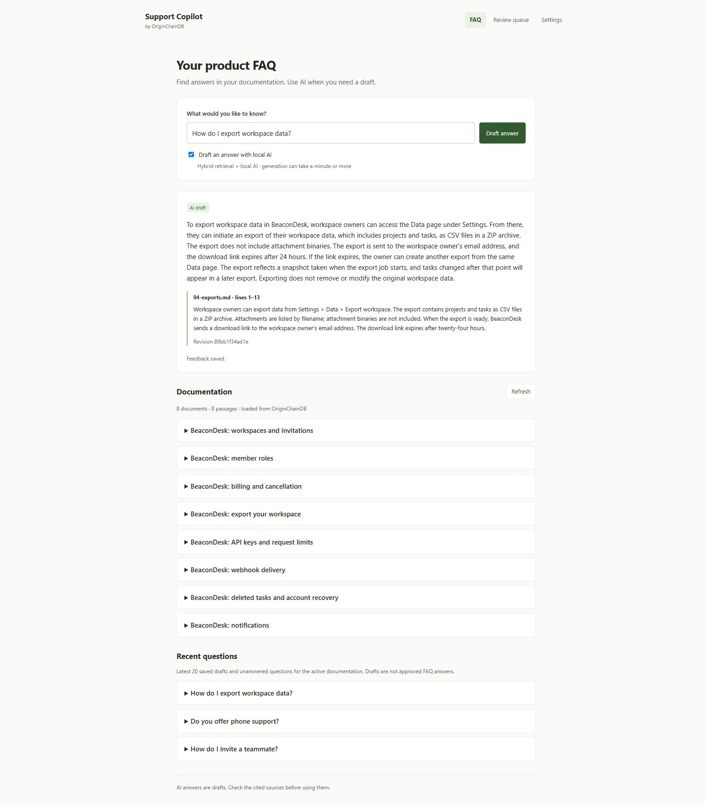
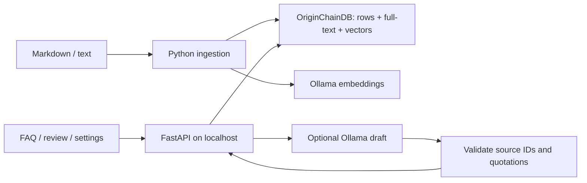

# OriginChainDB Support Copilot

[](https://github.com/originchaindb/originchaindb-support-copilot/actions/workflows/ci.yml)

A live FAQ workspace for startup founders: browse your product documentation,
search it, and optionally draft answers with local AI and source quotations.
Built with **Python, FastAPI, OriginChainDB, and Ollama**.

**Verified with OriginChainDB Cloud Free on 21 October 2026:** cloud ingestion,
keyword/vector/hybrid retrieval, cited drafts, history, and feedback passed
against a real Free development instance. See the [test evidence](docs/VERIFICATION.md).



## Three simple views

| View | What it shows |
| --- | --- |
| **FAQ** | Documents read from OriginChainDB, keyword search, optional AI drafting, and recent saved questions. |
| **Review queue** | Questions with missing evidence or negative feedback, read from the database. |
| **Settings** | A live database connection check, stored passage count, active snapshot, configured models, and payload sizes. No credentials. |

Search is the default and needs no generation model after ingestion. Check
**Draft an answer with local AI** for hybrid retrieval and a cited draft.
Settings are read-only; configuration stays in your server environment.

The included **BeaconDesk** documents are fictional sample data. They are
actually indexed and queried in OriginChainDB; there are no canned answers
or dashboard counters. Replace them with your own approved documentation.

## Run the app with OriginChainDB Cloud Free

You need Python 3.11+, [uv](https://docs.astral.sh/uv/getting-started/installation/),
[Ollama](https://ollama.com/download), and an OriginChainDB Cloud Free development database
with schema/row, SQL SELECT, full-text, and vector access.

The Python web app and Ollama run on your computer. The documents, search
indexes, questions, and feedback are stored in your cloud database.

In the [cloud console](https://app.originchaindb.com/instances), open your
**Free** development instance and select **Connect > Application API**. Copy
its HTTPS endpoint and tenant from that instance's connection example. The
tenant is a separate identifier; do not substitute the instance ID.
Use the instance key issued when the database was created as `OC_BEARER`.
The console does not display an existing key again. Replacing an instance
key immediately invalidates it for every client using the previous key.

```sh
git clone https://github.com/originchaindb/originchaindb-support-copilot.git
cd originchaindb-support-copilot
uv sync --extra dev --locked
```

Copy `.env.example` to `.env`:

```powershell
# Windows PowerShell
Copy-Item .env.example .env
```

```sh
# macOS / Linux
cp .env.example .env
```

Fill in your database's `OC_BASE_URL`, `OC_TENANT`, and `OC_BEARER` from its
connection details. The URL is the HTTPS origin, without `/v1` or a tenant
path. Set both `OC_DB_USER` and `OC_DB_KEY` only when your connection requires
database-user authentication. Never commit `.env`.

Start Ollama and pull the models:

```sh
ollama pull nomic-embed-text
ollama pull qwen2.5:3b
uv run support-copilot ingest sample_docs
uv run support-copilot serve
```

Open **http://127.0.0.1:8000**. Expand a document, search `export attachments`,
then try an AI draft for `How do I invite a teammate?`. Ask
`Do you offer phone support?` to inspect an unsupported question. Use **Needs
improvement** to send an answer to the review queue.

The model downloads are approximately 274 MB and 1.9 GB, using local disk.
If the GPU runtime fails, set `OLLAMA_CPU_ONLY=1` in `.env`. CPU generation
can take a minute or more; source search remains useful without generation.

## Use your product's documentation

Stop the web server, then ingest a small folder of UTF-8 Markdown or text:

```sh
uv run support-copilot ingest path/to/your-docs
uv run support-copilot serve
```

Refresh the FAQ. It will show that corpus. Recent questions are scoped to the
active snapshot; the review queue includes older questions in the workspace.
The starter accepts up to 100 files, 2 MB of source text, and 1,000 passages.
Changed documents create a new snapshot. **Old snapshots and question history
remain stored**; re-indexing is not deletion. See [retention](docs/ARCHITECTURE.md).

## What runs where



OriginChainDB persists source passages, search projections, questions, and
feedback. Python merges keyword/vector rankings using reciprocal rank fusion.
The browser receives only application data; model prompts receive documentation
and the question, never database credentials.

## Development and production

- [Development guide](docs/DEVELOPMENT.md): code map, API, tests, model setup,
  and the edit/ingest/run loop.
- [Production deployment guide](docs/PRODUCTION.md): a single-host internal
  deployment using systemd, Caddy HTTPS/authentication, and local Ollama.
  Configuration templates are in `deploy/`.
- [Founder use cases](docs/USE-CASES.md): support drafting, onboarding, API
  documentation, and finding documentation gaps.
- [Architecture and retention](docs/ARCHITECTURE.md): snapshots, stored data,
  and the limits of this starter.
- [References](docs/REFERENCES.md): official APIs and deployment documentation.

This starter has one shared corpus and no application user/role system.
Production instructions describe an authenticated **internal tool** and include
staging checks; they are not evidence of a deployed customer-facing service.
GitHub publication distributes source code, not a running database or hosted app.

## Cost and free-tier scope

[OriginChainDB pricing](https://originchaindb.com/pricing) lists one free database
per account with 1 GB of storage and shared scale-to-zero infrastructure
(checked 21 October 2026). The starter's core workflow passed on an actual
Cloud Free development instance. That account's console displayed a 2 GB
allowance and **No charge**; do not treat it as a promise of 2 GB for new accounts.
Check your own configuration. Used-storage metering and load limits were not measured.

There is no paid model API requirement. Hosting, hardware, electricity, and
network usage have their own costs. The Settings payload sizes exclude indexes,
WAL, metadata, history, and old snapshots; use the console's actual storage meter.

## Verification and limits

```sh
uv run --extra dev pytest -q
uv run --extra dev ruff check .
uv pip check
npm ci
npm test
uv run support-copilot evaluate --mode keyword
uv run support-copilot evaluate --mode vector
uv run support-copilot evaluate --mode hybrid
```

The optional frontend test suite requires Node.js 20+; serving the app does not.
The evaluator measures retrieval on 24 answerable sample questions. Six
unsupported questions need separate answer/abstention review. The sample set
is for development, not a held-out benchmark.

For a real development connection, run `uv run python scripts/smoke_live.py`.
It creates and retains a uniquely named test namespace. It does not delete
existing data. Full results and unresolved limits are in
[verification](docs/VERIFICATION.md).

For cloud verification, use:

```sh
uv run python scripts/smoke_live.py --require-cloud
```

This refuses local/private database addresses and tests repeat ingestion,
keyword/vector/hybrid retrieval, a cited draft, an unsupported question,
saved history, and feedback. Confirm **Free** in the console separately:
an HTTPS endpoint alone does not establish the billing plan. Test reports
contain sample data, not connection keys. When finished with a temporary
verification connection, stop the app and remove `.env` before sharing the
checkout. Keep your instance key in your own secret manager.

**A valid citation does not guarantee a correct answer.** A tested webhook
answer overstated what deduplication guarantees despite quoting a real passage.
Keep human review. There is no autonomous ticket sending, PDF crawling,
customer authentication, or per-customer corpus isolation.

## Troubleshooting

| Symptom | Action |
| --- | --- |
| No active corpus | Run `uv run support-copilot ingest sample_docs` from this checkout. |
| 401 / 403 | Check engine bearer, tenant, and optional database-user permissions. |
| 402 | Verify operation availability in your configuration; do not enable paid extras automatically. |
| 429 | Wait and retry. The app admits one AI draft at a time; the database may also rate-limit. |
| Ollama connection/GPU failure | Start Ollama, check `ollama list`, or set `OLLAMA_CPU_ONLY=1`. |
| Ollama HTTP 500 / memory allocation failure | Check the Ollama server log and available RAM; free resources before retrying. Keyword source search still works. |
| Embedding model changed | Stop serving and re-ingest before searching. |
| Invalid host behind a proxy | Set the exact hostname in `COPILOT_ALLOWED_HOSTS`; follow the production guide. |

MIT license covers this repository's original code and sample documents.
OriginChainDB, Ollama, and model weights retain their own licenses and terms.
See [contributing](CONTRIBUTING.md).
